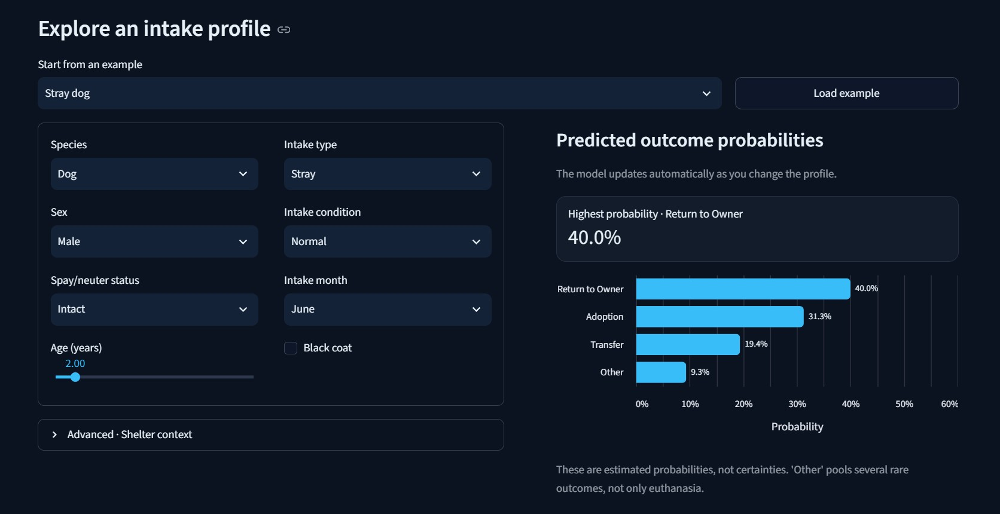
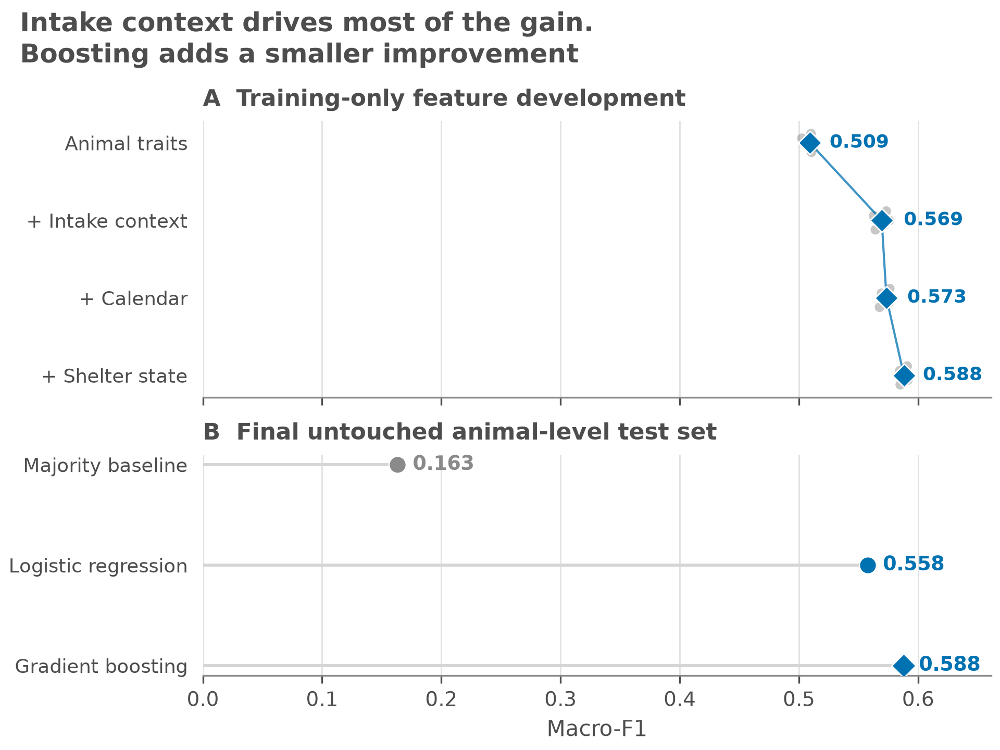
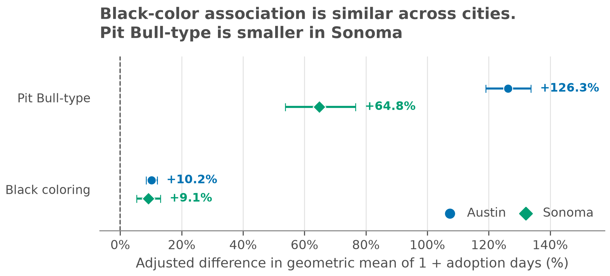
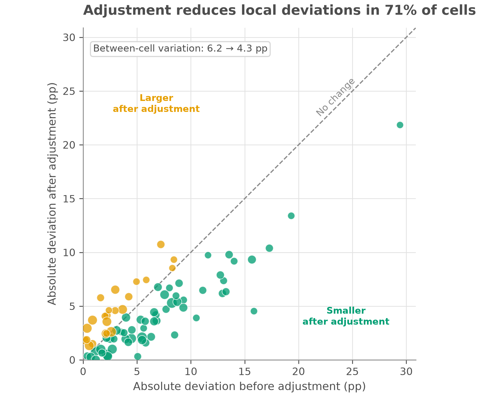

# What Intake Records Actually Tell You

**Applied machine learning and statistical inference for shelter outcomes, adoption delays, and stray-dog reunification.**

A completed research project by **Group 5, Hebrew University of Jerusalem**, for *A Needle in a Data Haystack* (67978).

[Explore the Streamlit demo](#interactive-demo) · [Research findings](#three-questions-three-findings) · [Read the illustrated report](writeup_group5.pdf) · [Reproduce the analyses](#reproduce-the-analyses)

## Three questions, three findings

| Research question | Main result |
| --- | --- |
| **Outcome prediction:** Can intake-time records predict Adoption, Return to Owner, Transfer, or Other? | Gradient boosting reaches **0.588 macro-F1** on an untouched animal-grouped test set, versus **0.558** for logistic regression and **0.163** for the majority baseline. |
| **Adoption delay:** Among eventual adoptees, are Pit Bull-type labels and black coloring associated with longer waits? | Adjusted Austin associations are **+126.3%** and **+10.2%**, respectively, in the model-implied geometric mean of **1 + adoption days**. Both remain positive in an independent Sonoma replication. |
| **Stray reunification:** How much does pickup geography add beyond measured dog traits? | Raw ZIP rates span **11.8%–38.7%**, yet adding ZIP barely improves held-out log loss (**0.4934 → 0.4921**) and slightly lowers AUC (**0.7584 → 0.7557**). |

Raw patterns change after adjustment or validation on new data. The [final report](writeup_group5.pdf) details cohort definitions, uncertainty, errors, and robustness checks. Adoption-delay estimates are associations, not causal effects or changes in expected raw days.

## Interactive demo

Explore the frozen Austin classifier in a **dark-themed Streamlit dashboard**. Start from an example intake profile, adjust the animal and shelter context, inspect four outcome probabilities, and compare two hypothetical profiles side by side. Differences are model responses, **not causal effects**.



Use **Python 3.13** and [uv](https://docs.astral.sh/uv/). From the repository root:

```sh
uv sync --locked
uv run streamlit run src/demo_app.py
```

The **frozen model** and metadata in [`demo_artifacts/`](demo_artifacts/) support inference with **no raw data, credentials, or retraining**.

The local app opens at `http://localhost:8501` by default. Its appearance is configured in [`.streamlit/config.toml`](.streamlit/config.toml). The comparison table can be downloaded as CSV.

The demo illustrates historical predictions, not operational shelter decisions. **Other is a pooled class, not a euthanasia probability.** The [artifact exporter](src/export_demo_artifact.py) retrains and overwrites the model; the demo does not need it.

## Methods and validation

### 1. Feature engineering and leakage-aware prediction

Outcomes are linked to each animal's most recent preceding intake. Feature engineering parses age, separates sex from altered status, groups intake/condition labels, and derives coat-color, calendar, and shelter-load features.

- **Temporal features:** occupancy and seven-day intake volume use complete event ledgers and only events strictly before intake. The volume window is `[t − 7 days, t)`.
- **Model comparison:** one-hot encoding feeds balanced multinomial logistic regression and class-balanced histogram gradient boosting; numeric features are standardized for logistic regression.
- **Held-out evaluation:** an animal-grouped 80/20 split yields 137,734 training and 34,423 test rows. Feature development uses five-fold animal-grouped cross-validation within training data, preserving the untouched test set. Macro-F1 and per-class diagnostics address class imbalance.
- **Forward-time check:** training before January 2023 and testing on later animals, excluding overlapping IDs, gives **0.557 macro-F1**.



**External validation on Sonoma.** After schema harmonization, Austin-trained classifiers achieve **0.404 macro-F1** with full features and **0.459** without calendar and shelter-state features, versus a **0.133** majority baseline. Classifiers never train on Sonoma. Shelter context helps within Austin but transfers poorly across cities.

### 2. Statistical inference for adoption delay

OLS models `log(1 + adoption days)` among eventual adoptees, adjusting for age, species, sex, altered status, intake type, and condition. Standard errors are **clustered by animal ID** for repeated stays. Reported associations use `100 × (exp(beta) − 1)`.

Austin's adjusted 95% intervals are **+119.1% to +133.7%** for Pit Bull-type labels and **+8.4% to +12.0%** for black coloring.

Sensitivity checks cover species subsets, stay cutoffs, intake-year fixed effects, and nonlinear age. Black coloring reverses from **−2.9% unadjusted** to **+10.2% adjusted**.


**Independent replication.** Refitting the same specification on **9,201 Sonoma adoptions** yields **+64.8%** for Pit Bull-type labels and **+9.1%** for black coloring. This replicates associations rather than testing unchanged Austin coefficients.



### 3. Spatial analysis and incremental predictive value

Census-geocoded numbered Austin street addresses support ZIP comparisons, hexagonal residual maps, and a **DBSCAN** check independent of ZIP boundaries. Reported ZIPs and cells require at least 60 dogs.

Traits-only and traits-plus-ZIP logistic models are compared across **five animal-grouped holdouts** using log loss, Brier score, and AUC. Brier score changes only **0.1608 → 0.1604**, reinforcing ZIP's small predictive contribution. After adjustment, dog-count-weighted between-cell variation falls from **6.2 to 4.3 percentage points**.




## Data and reproducibility

| Report snapshot | Raw records | Analytic cohort |
| --- | ---: | --- |
| [Austin intakes](https://data.austintexas.gov/d/wter-evkm), Oct. 2013–May 5, 2025 | 173,812 | Linked to outcomes by Animal ID and most recent preceding intake |
| [Austin outcomes](https://data.austintexas.gov/d/9t4d-g238), same period | 173,775 | 172,157 classification stays; 83,896 adopted stays; 26,045 geocoded stray dogs in 39 ZIPs |
| [Sonoma stays](https://data.sonomacounty.ca.gov/d/924a-vesw), intakes Aug. 2013–July 2026 | 33,718 | 25,508 filtered stays; 9,201 adoptions for trait replication |

### Environment and tests

[`pyproject.toml`](pyproject.toml) declares dependencies; [`uv.lock`](uv.lock) fixes the environment, including **scikit-learn 1.9.0** for model compatibility. The artifact was exported with Python **3.13.5**.

After the demo setup above, run the offline suite:

```sh
uv run python -m unittest discover -s tests -v
```

Synthetic tests cover joins, feature engineering, shelter-load edge cases, grouped splits, and spatial utilities; artifact tests check inference. No raw snapshots, credentials, network, or training are required.

For pip users, install the [pinned dependency export](requirements.txt) in a Python 3.13 environment:

```sh
python -m venv .venv
# PowerShell: ./.venv/Scripts/Activate.ps1
# POSIX: source .venv/bin/activate
python -m pip install -r requirements.txt
```

Then use `python` instead of `uv run python` below; launch the demo with `python -m streamlit run src/demo_app.py`.

### Reproduce the analyses

Raw datasets and the address-derived geocoding cache are not included in Git. Restore the original snapshots at these exact paths:

```text
data/
├── Austin_Animal_Center_Intakes_(10_01_2013_to_05_05_2025).csv
├── Austin_Animal_Center_Outcomes_(10_01_2013_to_05_05_2025).csv
├── sonoma_intake_outcome.csv
└── geocode_cache.csv
```

Use CSV exports with the source portals' original display-name headers. Austin's archived tables correspond to the report period. **Sonoma is a changing live table:** a fresh download is not the 33,718-row report snapshot. Exact numerical reproduction requires the original snapshots; loaders reject missing files and unexpected row counts, but row counts alone do not prove snapshot identity. No automatic downloader substitutes newer data.

With snapshots restored:

```sh
uv run python src/data_loader.py             # join and stay checks
uv run python src/outcome_classification.py  # benchmarks, errors, temporal check
uv run python src/hard_to_adopt_analysis.py  # adjusted traits and sensitivity checks
uv run python src/cross_city_validation.py   # Sonoma transfer and trait replication
```

Spatial analyses and the sample-flow figure additionally require the original `geocode_cache.csv`:

```sh
uv run python src/neighborhood_analysis.py
uv run python src/stray_hotspots.py
uv run python src/report_overview.py
```

To build a cache after restoring Austin intakes, run `uv run python src/geo_enrich.py`. This sends numbered street addresses to the U.S. Census batch geocoder and requires network access. Updated geocoder results can change coverage and geographic findings.

Scripts print results and regenerate figures under `figures/{report,analysis,interactive}/`; spatial holdout metrics go under `data/derived/`. Selected report PNGs are versioned; other generated outputs are ignored.

## Repository map

| Path | Purpose |
| --- | --- |
| [`src/`](src/) | Analysis entry points, shared preprocessing/modeling/spatial helpers, and demo |
| [`src/visualizations/`](src/visualizations/) | Figure generation and shared styling |
| [`tests/`](tests/README.md) | Offline regression tests and frozen-model inference checks |
| [`demo_artifacts/`](demo_artifacts/) | Frozen classifier and display metadata |
| [`figures/report/`](figures/report/) | Selected original report figures |
| [writeup_group5.pdf](writeup_group5.pdf) | Final illustrated report |
| [`experiments/rescuegroups/`](experiments/rescuegroups/README.md) | Excluded listing-text feasibility investigation |

**Excluded research direction:** a RescueGroups listing-text feasibility check found usable text and a valid duration in only **92/952 sampled records (9.7%)**; pre-adoption description versions could not be verified. The [saved findings](experiments/rescuegroups/rescuegroups_feasibility_report.md) document why this experiment does not feed the final analyses or demo.

## Limitations

- These administrative shelter records describe participating shelters, not the general animal population. Intake-only features omit later care, rescue-partner decisions, and ownership factors. Transfer recall is only **0.46** on Austin's test set.
- Trait estimates concern eventual adoptees only; shelter-recorded breed/color labels are imperfect. They do not estimate adoption probability or causal breed/color effects. Most adoption-time variation remains unexplained (Austin log-outcome R² = **0.150**).
- The shared primary stay filter is 0–730 days. Geographic coverage favors geocodable numbered street addresses; missingness may be systematic. Area associations do not establish individual effects, and geography was not externally validated in Sonoma.
- Animal-grouped splits reduce repeat-animal leakage; they do not establish prospective deployment performance. Occupancy is incomplete near the start of data collection. Cross-city recording differences and missing birth dates limit comparisons.
